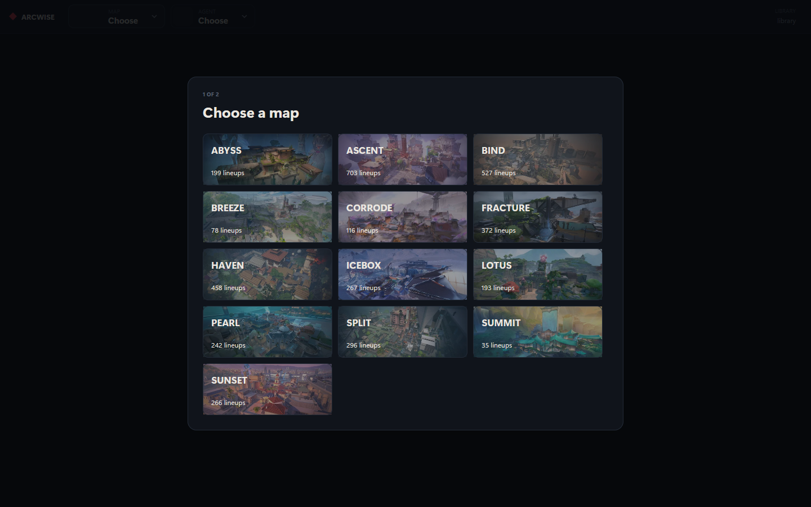
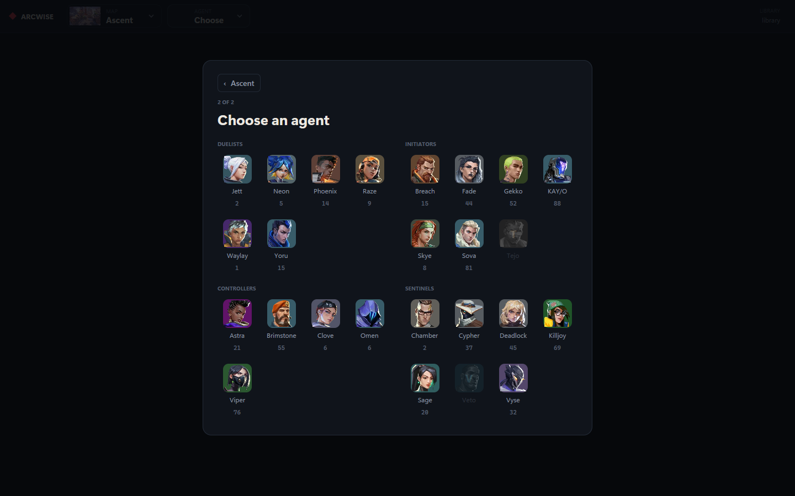

# Arcwise

[](https://github.com/265866/arcwise/actions/workflows/ci.yml)
[](https://github.com/265866/arcwise/releases/latest)

A desktop lineup browser for Valorant. Pick a map and an agent, see where each piece of utility
lands, and watch exactly where to stand, where to aim and how to throw.

Arcwise is a separate window, not an overlay: keep it on a second monitor while you play.



## Download

Get the installer from the [latest release](https://github.com/265866/arcwise/releases/latest):
`arcwise-<version>-x64-setup.exe`. It installs Arcwise for your Windows account only, so it
never asks for administrator rights, and adds it to the Start Menu. The release also has a zip
with the same `arcwise.exe` for running without installing.

Arcwise isn't code-signed yet. When you run an installer or an `arcwise.exe` you downloaded,
Windows may show "Windows protected your PC". Click **More info**, then **Run anyway**.

Installing a newer version over an older one keeps your settings. To remove Arcwise, open
**Settings** > **Apps**, find Arcwise in the list of installed apps, and choose **Uninstall**.
The uninstaller asks whether to delete your settings too.

### Check a download

This repository's release workflow builds every release on GitHub, and signs a statement that
names each file it built. The release attaches that statement as `attestation.json`. Download it
next to your file. Then check the file with the [GitHub CLI](https://cli.github.com/). With
`--bundle`, the check works without signing in:

```powershell
gh attestation verify arcwise-<version>-x64-setup.exe --repo 265866/arcwise --bundle attestation.json
```

It prints that verification succeeded, or why it failed.

Each release also lists the files' SHA-256 hashes in `SHA256SUMS.txt`. To compare one in
PowerShell, run `Get-FileHash arcwise-<version>-x64-setup.exe` and match its hash against the
file's line. The hash in `SHA256SUMS.txt` is lowercase.

## What it does

- **Map first, then agent.** The first run asks for a map, then an agent who has lineups on it.
  After that the header's pickers open as dropdowns, and Arcwise reopens where you left off.
- **Every landing on the map.** Lineups of one ability that land in the same place share a marker,
  with a count. Point at one to see what lands there and where it is thrown from.
- **Each stand spot for a landing.** Select a landing to see its stand spots, numbered, with the
  throw drawn from each.
- **The throw, step by step.** The panel plays the clip and has four views: the full clip, the map
  around the stand spot, the crosshair at the throw, and where it lands. A note over the clip says
  when the throw is more than a plain click, such as a jump throw.
- **Hardware video.** Clips decode on the GPU through Windows Media Foundation and play at full
  frame rate even while another window has focus, at about an eighth of one CPU core.



## Keyboard

| Keys | Does |
| --- | --- |
| <kbd>↑</kbd> <kbd>↓</kbd> | Previous or next landing |
| <kbd>←</kbd> <kbd>→</kbd> | Previous or next stand spot for the landing |
| <kbd>1</kbd> to <kbd>9</kbd> | All abilities, then one ability at a time |
| <kbd>Q</kbd> <kbd>W</kbd> <kbd>E</kbd> <kbd>R</kbd> | Clip, stand spot, aim, landing |
| <kbd>Space</kbd> | Pause or play the clip |
| <kbd>S</kbd> | Slow motion: ½×, then ¼×, then back to full speed |
| <kbd>Tab</kbd> | Attack or defense |
| <kbd>Esc</kbd> | Close the picture, menu, chooser or lineup |

## Lineups

Arcwise does not come with lineups or download any. It reads a library folder on your computer;
[docs/library-format.md](docs/library-format.md) describes the layout. On first run it asks for
the folder, and the settings menu, behind the gear at the top right, opens another one.

## Appearance

The settings menu switches between the dark theme, which Arcwise starts with, and a light one.
It also turns background blur on or off and sets how much of it shows.

Arcwise's header doubles as its title bar: drag it to move the window, double-click it to
maximize, and use the minimize, maximize and close buttons at its right. To use Windows' own
title bar instead, turn off **Custom title bar** in the settings menu and click **Relaunch**.

## Updates

When an installed Arcwise opens, it asks GitHub whether a newer release exists. With
**Automatic updates** on in the settings menu, as they are at first, Arcwise downloads the new
installer in the background and installs it when you close Arcwise. Before that, it checks the
installer's attestation as `gh attestation verify` does, and that the release workflow built that
exact installer on `main`. An installer that fails the check is deleted, and a message links to
the releases page instead.

With **Automatic updates** off, a message says a new version is available, and a badge shows on
the settings gear. The bottom of the settings menu shows the version you have and the new one,
with a button that updates Arcwise and relaunches it.

An `arcwise.exe` run from the zip doesn't update itself. Get new versions from the
[releases page](https://github.com/265866/arcwise/releases/latest).

The check is one request to GitHub's API for the latest release, made whether automatic updates
are on or off. It names Arcwise and its version as the user agent and sends nothing else, though
GitHub sees your IP address, as it does for any visit. Arcwise downloads an installer and its
attestation only to install a newer version.

## Requirements

- Windows 10 or 11 with a Direct3D 11 GPU.
- For AV1 clips, the [AV1 Video Extension](https://apps.microsoft.com/detail/9mvzqvxjbq9v) from
  the Microsoft Store. Windows 11 usually has it already.

## Contributing

[CONTRIBUTING.md](CONTRIBUTING.md) covers building Arcwise, its tests, how changes land and how
releases ship.

## License

[MIT](LICENSE). Release builds include `THIRD-PARTY-LICENSES.html` for the open-source crates
Arcwise is built with.

Arcwise isn't endorsed by Riot Games and doesn't reflect the views or opinions of Riot Games or
anyone officially involved in producing or managing Riot Games properties. Riot Games, and all
associated properties are trademarks or registered trademarks of Riot Games, Inc.
