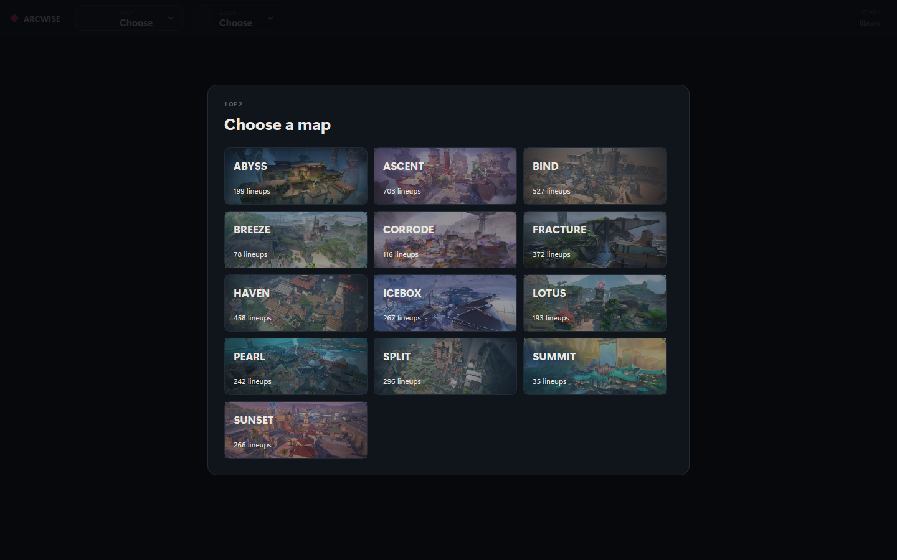
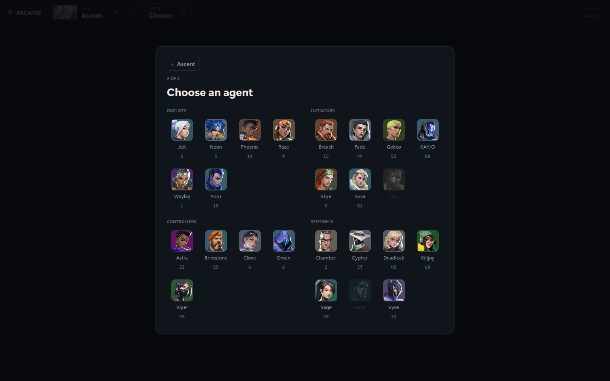

# Use Arcwise

Arcwise is a desktop lineup browser for Valorant. Pick a map and an agent, see where each piece of
utility lands, and watch exactly where to stand, where to aim and how to throw. It is a separate
window, not an overlay: keep it on a second monitor while you play.

## Install on Windows

Get the installer from the [latest release](https://github.com/265866/arcwise/releases/latest):
`arcwise-<version>-x64-setup.exe`. It installs Arcwise for your Windows account only, so it
never asks for administrator rights, and adds it to the Start Menu. The release also has a zip,
`arcwise-<version>-x64.zip`, with the same `arcwise.exe` for running without installing. You
need one or the other, not both. [Verify a release](verifying-releases.md) shows how to check
either file before you run it.

Arcwise isn't code-signed yet. When you run an installer or an `arcwise.exe` you downloaded,
Windows may show "Windows protected your PC". Click **More info**, then **Run anyway**.

Installing a newer version over an older one keeps your settings. To remove Arcwise, open
**Settings** > **Apps**, find Arcwise in the list of installed apps, and choose **Uninstall**.
The uninstaller asks whether to delete your settings too.

## What it does

- **Map first, then agent.** The first run asks for a map, then an agent who has lineups on it.
  After that the header's pickers open as dropdowns, and Arcwise reopens where you left off,
  unless **Open where I left off** is turned off under **General** in the settings.
- **Every landing on the map.** Lineups of one ability that land in the same place share a marker,
  with a count. Point at one to see what lands there and where it is thrown from.
- **Each stand spot for a landing.** Select a landing to see its stand spots, numbered, with the
  throw drawn from each.
- **The throw, step by step.** The panel plays the clip and has four views: the full clip, the map
  around the stand spot, the crosshair at the throw, and where it lands. A note over the clip says
  when the throw is more than a plain click, such as a jump throw.
- **Hardware video.** Clips decode on the GPU through Windows Media Foundation and play at full
  frame rate even while another window has focus, at about an eighth of one CPU core.

## Keyboard

| Keys | Does |
| --- | --- |
| <kbd>↑</kbd> <kbd>↓</kbd> | Previous or next landing |
| <kbd>←</kbd> <kbd>→</kbd> | Previous or next stand spot for the landing |
| <kbd>1</kbd> to <kbd>9</kbd> | All abilities, then one ability at a time |
| <kbd>Q</kbd> <kbd>W</kbd> <kbd>E</kbd> <kbd>R</kbd> | Clip, stand spot, aim, landing |
| <kbd>Space</kbd> | Pause or play the clip |
| <kbd>Backspace</kbd> | Play the clip again from the start |
| <kbd>S</kbd> | Slow motion: ½×, then ¼×, then back to full speed |
| <kbd>Tab</kbd> | Attack or defense |
| <kbd>Esc</kbd> | Close the picture, settings, chooser or lineup |
| <kbd>Ctrl</kbd> <kbd>,</kbd> | Open or close the settings |

These are the defaults. Change them in the settings, under Keyboard: a shortcut can have Ctrl,
Alt and Shift, and each command can have two. Esc and the number keys stay as they are.

## Lineups

Arcwise shows the lineups of https://library.arcwise.lol, streaming each clip and picture when
it is first shown and keeping it for next time. The settings' **General** tab (the gear at the
top right, or <kbd>Ctrl</kbd> <kbd>,</kbd>) lists the libraries it shows:

- Tick or untick a library to show or hide its lineups. Lineups from every library ticked show
  together.
- **Folder…** adds a library folder on your computer. To add a library on the web, copy its
  address and click **Paste address**.
- **Offline…** keeps a library's maps on your computer, chosen one by one or all of them, so their
  lineups play without a connection. When the library changes, Arcwise fetches only what changed.
  Unticking a map deletes its clips to free the room.
- **Remove** takes a library off the list. For a library on the web, it also deletes the copy
  Arcwise keeps of it.

Without a connection, Arcwise shows a library on the web as it was last fetched. The
[arcwise-library](https://github.com/265866/arcwise-library) repository describes the library
format and publishes a library to the web; [Libraries](library-format.md) says what Arcwise does
with one.

## Appearance

The settings' **Appearance** tab switches between the dark theme, which Arcwise starts with, a
light one, and **System**, which follows Windows' light or dark mode as it changes. It also turns
background blur on or off and sets how much of it shows.

Under **Playback**, **Starting speed** sets the speed clips play at when Arcwise opens: full,
half or a quarter. Slow motion still changes it as a clip plays.

Arcwise's header doubles as its title bar: drag it to move the window, double-click it to
maximize, and use the minimize, maximize and close buttons at its right. To use Windows' own
title bar instead, turn off **Custom title bar** under **Appearance** and click **Relaunch**.

Arcwise reopens where you left it: on the same monitor, at the same size, and maximized if it
was. If that monitor isn't connected, it opens in the middle of your main one.

## Updates

An installed Arcwise asks GitHub whether a newer release exists when it opens, and every hour
while it stays open. With **Automatic updates** on in the settings' **Updates** tab, as they are
at first, Arcwise downloads the new installer in the background and installs it when you close
Arcwise; **Restart now** in that tab installs it at once. Before that, it checks the
installer's attestation as `gh attestation verify` does, and that this repository's release
workflow built that exact installer on `main`. An installer that fails the check is deleted, and
a message links to the releases page instead.

With **Automatic updates** off, a message says a new version is available when you open Arcwise.
Either way, a badge shows on the settings gear until the new version is installed, and the
**Updates** tab shows the version you have and the new one, with a button that updates Arcwise and
relaunches it. After an update, Arcwise says which version it is now. **Check now** asks GitHub
at once, and **What's new** opens the list of releases.

An `arcwise.exe` run from the zip doesn't update itself. Get new versions from the
[releases page](https://github.com/265866/arcwise/releases/latest).

The check is one request to GitHub's API for the latest release, made whether automatic updates
are on or off. It names Arcwise and its version as the user agent and sends nothing else, though
GitHub sees your IP address, as it does for any visit. Arcwise downloads an installer and its
attestation only to install a newer version.

Arcwise 0.10.0 and earlier trust only the repository they were released from, which this one
replaces, so they can't update themselves to a release from here. Install a release from here
once by hand, over the old one; it keeps your settings, and updates itself from then on.

## Requirements

- Windows 10 or 11 with a Direct3D 11 GPU.
- For AV1 clips, the [AV1 Video Extension](https://apps.microsoft.com/detail/9mvzqvxjbq9v) from
  the Microsoft Store. Windows 11 usually has it already.

## Command line

`arcwise [--library DIR] [--map NAME] [--agent NAME] [--side attack|defense] [--lineup ID]
[--view clip|stand|aim|lands]` opens on that library, map, agent, side, lineup and view. An
argument Arcwise doesn't know opens the window with the error. `arcwise --version` prints the
version and exits; from a console, pipe or redirect it, such as `arcwise --version | more`, since
Arcwise is a windowed program and has no console of its own.
